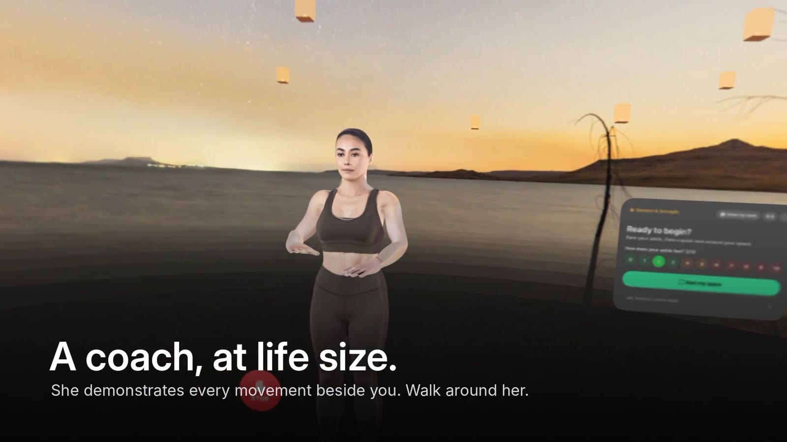
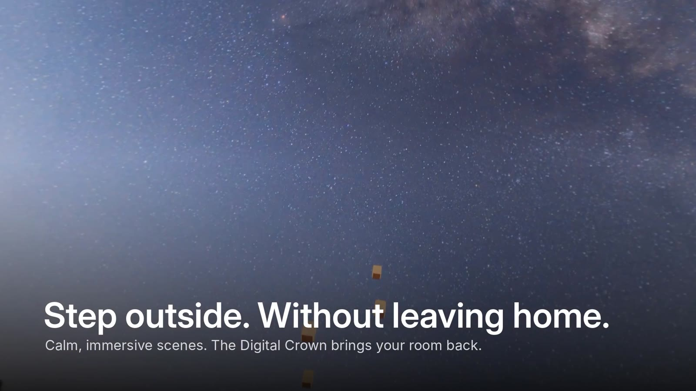
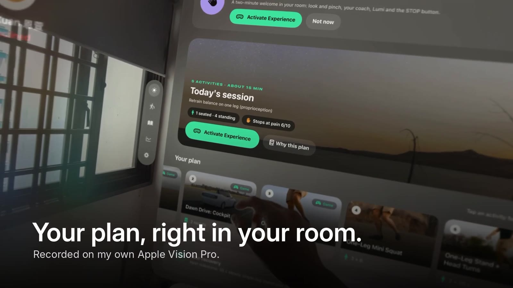
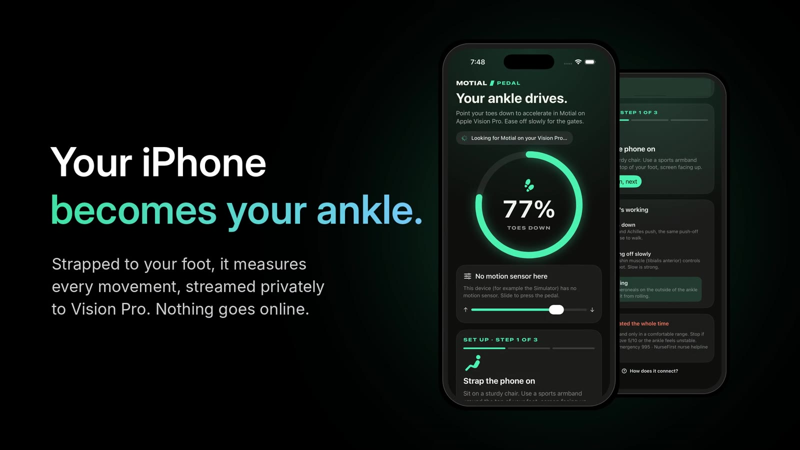
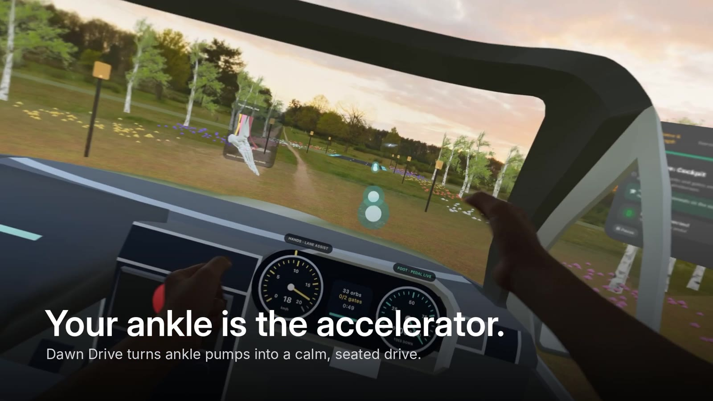
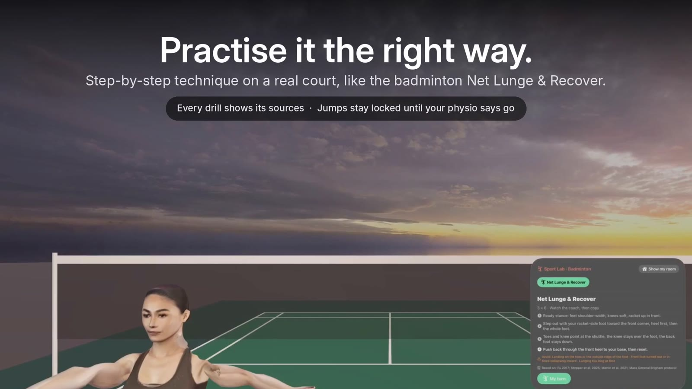
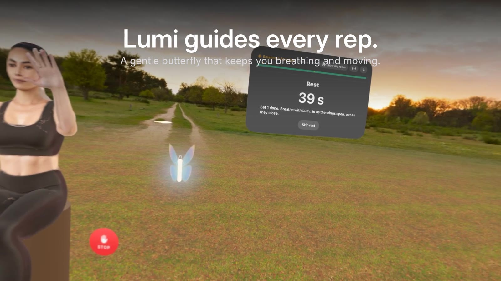
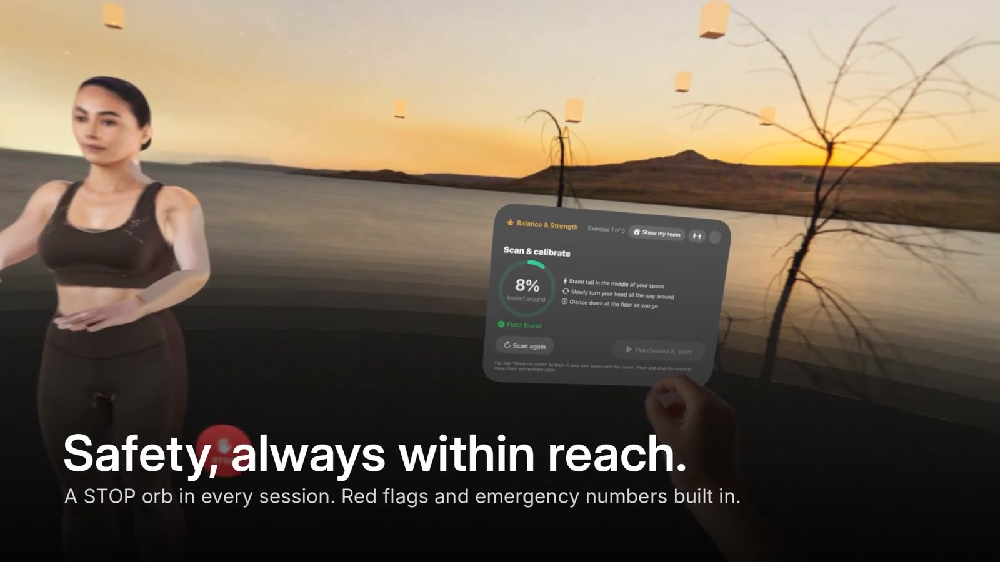

# Motial · Every Step Counts

**Ankle-sprain rehabilitation for Apple Vision Pro, with your iPhone as a foot sensor.**

Teoh En Xuan · Spatial Computing and AI · NUS Industrial Design · 2026



▶️ **[Watch the 65-second pitch video](media/Motial_Pitch_Video.mp4)** · Full app demo: [youtu.be/f3jrQV0mBeA](https://youtu.be/f3jrQV0mBeA)

---

## The problem

A sprain heals, but the ankle often doesn't. About 40% of people develop chronic ankle instability within a year of a first lateral ankle sprain (Doherty et al., 2016), yet unsupervised home balance training cuts re-sprains by about 35% (Hupperets et al., 2009). Most people go home with a printed exercise sheet and are left with three questions:

1. Which exercises, at which stage?
2. Am I doing the movement right?
3. When is it safe to jump and play again?

## What Motial does

| | |
|---|---|
|  | **Calm, immersive scenes.** Rehab that feels like stepping outside. The Digital Crown brings your room back. |
|  | **A coach at life size.** A 3D coach demonstrates every exercise beside you; walk around her to see each angle. |
|  | **A plan that moves with you.** Four stages from the JOSPT 2021 guideline (Protect & Move, Load & Restore, Balance & Strength, Return to Activity). A daily pain check-in adapts the plan. |
|  | **Motial Pedal.** Vision Pro can't see feet, so the iPhone strapped to the foot becomes a live ankle sensor, streamed over the local network. Nothing goes online. |
|  | **Dawn Drive.** A calm, seated drive where your ankle is the accelerator and your hands steer. Comfort rules follow Apple's motion guidance. |
|  | **Sport Lab and Play Smart.** Relearn your sport the right way: badminton, basketball, football and running drills, each with its clinical sources. Jumps stay locked until a physiotherapist clears them. |
|  | **Lumi.** A butterfly guide that lands on your open palm and keeps you breathing and moving. |
|  | **Safety first.** Ottawa Ankle Rules and red-flag screening, a STOP orb in every session, Singapore emergency 995 and NurseFirst 6262 6262. |

## Run it

1. A Mac with Apple silicon and **Xcode 16 or newer** (the project targets visionOS 2.0 and also builds with Xcode 26).
2. Open `SteadyAnkle/SteadyAnkle.xcodeproj` (the folder and target keep the original working name; the app's display name is **Motial**).
3. Select the **SteadyAnkle** target → *Signing & Capabilities* → choose your team (change the bundle ID if needed).
4. Run on **Apple Vision Pro** (recommended: hand tracking, games and Lumi need the device) or the **Apple Vision Pro simulator** (UI, coach, anatomy and scenes).
5. iPhone companion: open `SteadyAnkle/Companion/SteadyShin/SteadyShin.xcodeproj` ("Motial Pedal", iOS 17) and run it on an iPhone on the same Wi-Fi.

### Note on stock video

Third-party stock sports clips (`Resources/Videos/video_*.mp4`, from Mixkit) are **not included** in this public repository because their licence does not allow redistribution. The app still builds and runs; the Play Smart sport videos simply won't play. To restore them, add your own clips with the same file names to `SteadyAnkle/SteadyAnkle/Resources/Videos/`. The 180° court clips (`court180_*.mp4`) are original Blender renders and are included.

## Project layout

```
SteadyAnkle/
  SteadyAnkle.xcodeproj         visionOS app (display name: Motial)
  SteadyAnkle/
    SteadyApp.swift             app entry: main window, anatomy volume, immersive spaces
    Model/                      clinical engine (stages, plan, adaptation, hop gating), exercise & sport libraries
    Views/                      onboarding, Today, Play, Sport Lab, settings, brand system
    Immersive/                  session controller, coach rig, environments, motion tracking, STOP orb
    Immersive/Games/            Dawn Drive, Ankle Alphabet, Balance Bloom, One-Leg Catch, River Stones and more
    Audio/                      music, ambience, spatial sound effects, voice clips
    Resources/                  3D models, environments, voice, data
  Companion/SteadyShin/         Motial Pedal (iPhone ankle sensor)
  Docs/                         previews and design documentation
  Tools/AssetPipeline/          scripts for coach retargeting and asset generation
media/                          pitch video and pictures
```

## Clinical basis

Martin RL et al., JOSPT 2021 (lateral ankle sprain CPG) · Vuurberg G et al., BJSM 2018 · Doherty C et al., BJSM 2017 and AJSM 2016 · Dubois & Esculier, PEACE & LOVE, BJSM 2020 · Hupperets MDW et al., BMJ 2009 · Smith MD et al., PAASS framework, BJSM 2021 · Gribble PA et al., J Athl Train 2014 · Fu L et al., 2017 · Stepper B et al., 2025 · Ulrich RS, Science 1984.

Motial is a student prototype. It is not a medical device, does not diagnose injuries and does not replace a clinician.
